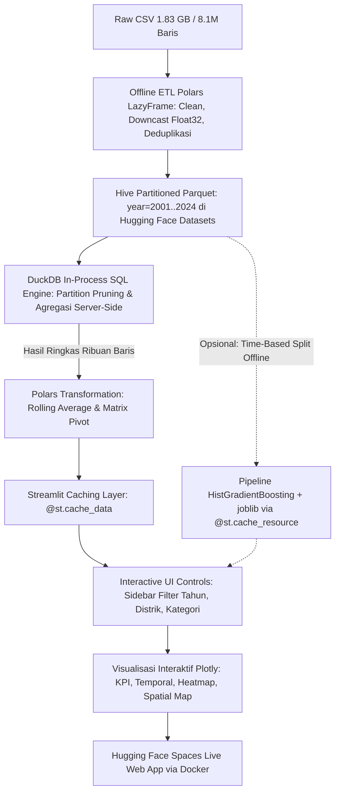

# Dokumen Arsitektur & Pitch Proposal Produk Data (Phase 1)

**Mata Kuliah:** Analisis Big Data  
**Target Check-in:** Pertemuan 10 (Diumumkan Pertemuan 8, repositori dibagikan Pertemuan 9)  
**Nama Tim:** Wind City  
**Topik / Judul Produk Data:** Chicago Crime Intelligence Dashboard: Analisis Spasio-Temporal & Evaluasi Efektivitas Penindakan Kriminalitas (2001–2024)  

---

## 1. Problem Statement & Sasaran Pengguna (The Pitch)

### 1.1 Latar Belakang Masalah
Kota Chicago mencatat lebih dari **8,1 juta laporan insiden kriminal** sepanjang periode Januari 2001 hingga Juli 2024 (~1,83 GB data mentah). Berdasarkan hasil *profiling* awal, terdapat kesenjangan serius antara volume kejahatan dan tingkat penangkapan (*arrest rate*): jenis kejahatan dengan volume tertinggi seperti **Theft** (1,71 juta kasus), **Criminal Damage** (923 ribu kasus), **Burglary** (433 ribu kasus), dan **Motor Vehicle Theft** (406 ribu kasus) memiliki tingkat penangkapan di bawah **11%**, sangat kontras dengan kasus **Narcotics** (754 ribu kasus) yang mencapai **99,35%**.

Di sisi teknis, data sebesar ini mustahil diolah secara interaktif menggunakan *spreadsheet* konvensional (yang terbatas ~1 juta baris), serta mengandung permasalahan kualitas data—termasuk **89.642 baris (1,11%) tanpa koordinat spasial** dan anomali *outlier* koordinat di luar batas geografis Kota Chicago (seperti lintang `36.61°` dan bujur `-91.68°`). Oleh karena itu, dibutuhkan produk data (*dashboard* analitik) yang cepat, bersih, dan teruji agar pemangku kepentingan dapat menelusuri pola jam rawan, pergeseran tren tahunan, serta titik *hotspot* secara interaktif tanpa hambatan memori.

### 1.2 Target Pengguna (Target Audience)
1. **Analis Operasional & Komandan Distrik Kepolisian (Chicago Police Department / CPD):** Membutuhkan pemetaan *hotspot* spasial dan jam rawan per distrik (`District` & `Beat`) untuk mengoptimalkan penjadwalan patroli preventif.
2. **Pembuat Kebijakan Pemerintah Kota (*City Council / Ward Planners*):** Membutuhkan evaluasi tren kriminalitas jangka panjang, rasio kasus kekerasan rumah tangga (`Domestic`), dan efektivitas penindakan per `Community Area` sebagai dasar alokasi anggaran keamanan publik.
3. **Peneliti Kriminologi & Masyarakat Umum:** Membutuhkan akses transparan untuk memahami profil risiko keamanan berbasis jenis lokasi (`Location Description`) dan musim (*seasonality*).

### 1.3 Nilai Tambah & Wawasan Utama
Setelah berinteraksi dengan *dashboard* ini, pengguna dapat mengambil keputusan berbasis data (*data-driven decisions*) berikut:
* **Alokasi Patroli Berbasis Waktu & Lokasi:** Mengidentifikasi kombinasi **Hari × Jam Rawan** dan klaster `District` / `Community Area` dengan kepadatan insiden tertinggi.
* **Audit Kesenjangan Penindakan (*Arrest Gap*):** Menemukan kategori kejahatan dan distrik dengan volume kasus tinggi namun *arrest rate* rendah untuk perbaikan strategi investigasi.
* **Deteksi Pergeseran Tren & Musiman:** Membedakan fluktuasi musiman rutin (lonjakan musim panas vs penurunan musim dingin) dari lonjakan anomali pasca-perubahan kebijakan atau ekonomi.
* **Simulasi Risiko Penindakan *(Fitur Lanjutan Opsional)*:** Memperkirakan probabilitas penangkapan (`Arrest`) berdasarkan profil waktu, jenis kejahatan, lokasi, dan status domestik melalui model *Machine Learning* ringan.

---

## 2. Sumber Dataset & Skala Data

| Parameter | Keterangan |
|-----------|------------|
| **Nama Dataset** | Chicago Crime Dataset (2001–2024) |
| **Sumber Resmi** | [Hugging Face — gymprathap/Chicago-Crime-Dataset](https://huggingface.co/datasets/gymprathap/Chicago-Crime-Dataset) (bersumber dari City of Chicago Data Portal) |
| **Format Awal** | CSV mentah (1.825,6 MB) → dikonversi menjadi Apache Parquet (kompresi Zstd, *Hive Partitioned* per tahun `year=YYYY`) |
| **Ukuran Data** | **1.825,6 MB (~1,83 GB)** \| **8.104.658 baris mentah** (**8.014.867 baris bersih** pasca-validasi koordinat dan waktu) |
| **Dimensi Waktu / Temporal** | 1 Januari 2001 – 4 Juli 2024 (23,5 tahun, resolusi hingga tingkat menit/detik) |
| **Fitur / Kolom Kunci** | `id`, `datetime`, `year`, `primary_type`, `description`, `location_description`, `arrest`, `domestic`, `district`, `beat`, `ward`, `community_area`, `latitude`, `longitude` |

---

## 3. Diagram Arsitektur Data & Aliran Informasi

Alur sistem memisahkan tahap pembersihan dan partisi *offline* (ETL) dari tahap kueri *online* agar aplikasi Streamlit tidak pernah memuat jutaan baris mentah sekaligus ke RAM server:

---

## 4. Rencana Pemrosesan Data & Strategi Caching

### 4.1 Peran DuckDB (SQL Engine)
* **Pembacaan Berbasis *Partition Pruning*:** DuckDB membaca langsung direktori file Parquet berpartisi temporal (`data/processed/chicago_crimes/year=*/data.parquet`). Saat pengguna memfilter rentang tahun tertentu (mis. 2020–2024), folder tahun 2001–2019 langsung dilewati (*0 byte I/O*), memangkas waktu kueri menjadi di bawah 1 detik.
* **Delegasi Operasi Analitik Berat (*Server-Side Aggregation*):** Seluruh agregasi pada 8,01 juta baris didelegasikan ke DuckDB di modul `src/queries.py`, mencakup:
  * Validasi kualitas dan ringkasan statistik (`SUMMARIZE`).
  * Perhitungan metrik KPI (*total kasus*, *arrest rate*, rasio *domestic*) dan *Year-over-Year* (YoY) menggunakan **SQL Window Functions** (`LAG()`, `SUM() OVER (... ROWS BETWEEN UNBOUNDED PRECEDING AND CURRENT ROW)`).
  * Agregasi spasial berbasis *grid binning* (`ROUND(latitude, 3)`, `ROUND(longitude, 3)`) untuk menghasilkan peta kepadatan (*hotspot*) yang akurat tanpa mengirim jutaan titik koordinat ke browser.

### 4.2 Peran Polars (Transformasi Data)
* **Tahap *Offline* ETL (`src/utils.py`):** Menggunakan *Lazy Evaluation* (`pl.scan_csv` → `sink_parquet`) agar pemrosesan 1,83 GB berjalan *streaming* tanpa *Out-of-Memory* (OOM). Transformasi meliputi standarisasi nama kolom ke `snake_case`, parsing `datetime`, penghapusan 89.642 baris *null* koordinat/waktu, penyaringan *bounding box* geografis Chicago (`Latitude` 41.60–42.05; `Longitude` -87.95 s.d. -87.50), deduplikasi kunci `id`, pembuangan kolom redundan (`location`, `x_coordinate`, `y_coordinate`, `updated_on`), serta *downcasting* tipe numerik (`Float64` → `Float32` untuk koordinat; `Int64` → `Int16` untuk `year`, `district`, `beat`, `ward`, `community_area`; kolom `id` tetap `Int64`) untuk menghemat memori.
* **Tahap Transformasi Analitik Ringkas:** Menerima hasil agregasi dari DuckDB untuk operasi temporal lanjutan seperti *downsampling* (`group_by_dynamic`), perhitungan rata-rata bergerak (*moving average* 12 bulan via `rolling_mean`), ekstraksi fitur kalender (`hari`, `jam`, `is_weekend`), serta penyusunan tabel pivot untuk *heatmap* jam rawan.

### 4.3 Strategi Optimasi Memori & Caching Streamlit
Lingkungan Hugging Face Spaces gratis memiliki keterbatasan sumber daya komputasi (CPU 2 vCPU, RAM 16 GB). Untuk menjaga keandalan (*reliability*) aplikasi saat diakses banyak pengguna:
1. **Zero Raw-Data in Session State:** Aplikasi **tidak pernah** memuat 8 juta baris mentah ke dalam `st.session_state` maupun mengubahnya penuh ke Pandas DataFrame. Hanya hasil agregasi ringkas (ratusan hingga ribuan baris) yang masuk ke memori UI.
2. **Fungsi Kueri Ter-cache (`@st.cache_data`):** Seluruh fungsi di `src/queries.py` dibungkus `@st.cache_data(ttl=3600, max_entries=64)` dengan argumen parameter filter (*tahun*, *distrik*, *kategori kejahatan*, *status arrest/domestic*) sehingga perpindahan tab atau perubahan filter yang berulang tidak mengeksekusi ulang kueri ke disk.
3. **Pemisahan File Data dari Repositori Git:** File dataset Parquet berpartisi disimpan di **Hugging Face Datasets** (diabaikan melalui `.gitignore`) dan ditarik otomatis saat inisialisasi *container* agar repositori GitHub tetap ringan di bawah batas 100 MB.
4. **Pemuatan Model ML Efisien *(Opsional)*:** Jika tab prediksi diaktifkan, model `HistGradientBoostingClassifier` yang dibungkus Scikit-learn `Pipeline` + `ColumnTransformer` (dilatih *offline* menggunakan *time-based split* agar bebas *data leakage*) disimpan sebagai file `.joblib` ringan dan dimuat satu kali memakai `@st.cache_resource`.

---

## 5. Rencana Tampilan Dashboard (Wireframe & Fitur UI)

1. **Header & Key Metrics KPI:**
   * Judul analitik, indikator rentang periode aktif, serta **4 Kartu Metrik KPI** dinamis:
     1. **Total Insiden Kriminal** (beserta delta % *Year-over-Year* terhadap periode sebelumnya).
     2. **Tingkat Penangkapan (*Arrest Rate*)** dalam persentase.
     3. **Proporsi Kasus Domestik (*Domestic Rate*)** dalam persentase.
     4. **Kategori & Distrik Paling Rawan** pada filter aktif.
2. **Filter Interaktif (Sidebar):**
   * *Slider* rentang tahun (`2001–2024`) yang memicu *partition pruning* DuckDB.
   * *Multiselect* Kategori Kejahatan (`Primary Type` — default Top 10 atau Semua).
   * *Multiselect* Distrik Kepolisian (`District` 1–25).
   * *Toggle* / *Selectbox* Status Penangkapan (`Semua` / `Arrested` / `Not Arrested`) dan Kasus Domestik (`Semua` / `Domestic` / `Non-Domestic`).
3. **Panel Visualisasi Utama (Multi-Tab):**
   * **Tab 1 — Tren Temporal & Pola Musiman:** *Line chart* interaktif jumlah kasus bulanan dilengkapi *range slider* dan garis *moving average* 12 bulan, serta **Heatmap Hari vs Jam Kejadian** untuk identifikasi jam rawan patroli.
   * **Tab 2 — Analisis Distribusi & Kesenjangan Penindakan:** *Horizontal bar chart* Top 10 `Primary Type` berdampingan dengan *Arrest Rate* (menyoroti *arrest gap*), ditambah *Box plot* distribusi insiden harian per distrik untuk mendeteksi lonjakan anomali.
   * **Tab 3 — Peta Wilayah / Spasial (*Hotspot*):** *Density Mapbox* interaktif berbasis agregasi *grid* koordinat Chicago (menampilkan konsentrasi titik rawan) dilengkapi grafik Top 10 `Community Area` dan `Location Description` (mis. `STREET`, `RESIDENCE`, `APARTMENT`).
   * **Tab 4 — Tabel Data Detail & Ekspor:** Tabel ringkasan agregasi terfilter (per tahun, distrik, kategori, total kasus, dan *arrest rate*) lengkap dengan tombol **Download CSV** untuk kebutuhan pelaporan eksternal.
   * **Tab 5 *(Opsional — Nilai Tambah ML)* — Prediksi Peluang Penangkapan:** Formulir simulasi skenario insiden (Kategori, Lokasi, Distrik, Jam, Hari, Domestik) yang menampilkan estimasi probabilitas penangkapan beserta faktor pendorong utamanya (*feature importance*).

---

## 6. Pembagian Tugas & Tanggung Jawab Anggota Tim

*(Seluruh anggota berkontribusi melalui branch masing-masing dan Pull Request dengan code review silang, sehingga kontribusi individu tercatat jelas di riwayat commit dan lolos `lint_check.yml` di GitHub Actions).*

| Anggota Tim | Peran & Tanggung Jawab Utama di Phase 1 – 4 |
|-------------|---------------------------------------------|
| **Tricahyo Diqolbu** | **Data Engineer & DevOps Lead:** Penyusunan `docs/architecture.md` & `data/README.md`, pipeline ETL Polars *lazy* (`src/utils.py`), pembuatan partisi Hive Parquet ke Hugging Face Datasets, `requirements.txt`, `Dockerfile`, pemeliharaan `lint_check.yml`, serta *staging* & *production deployment* di Hugging Face Spaces. Pada tahap akhir mengerjakan Tab 3 (peta spasial) dan Tab 4 (tabel & ekspor CSV). |
| **M. Rayhan Shaffarukhan Alkamaly** | **Analytics, Query & UI Engineer:** Perancangan seluruh kueri DuckDB di `src/queries.py` (*partition pruning*, *window functions*, *spatial binning*), optimasi `@st.cache_data`, pengembangan antarmuka Streamlit (`app.py`) beserta filter sidebar dan grafik Plotly Tab 1–2, serta produksi video demo. |
| **Bersama** | Penyelesaian `README.md` final, AI Disclosure Statement, dan persiapan presentasi. |